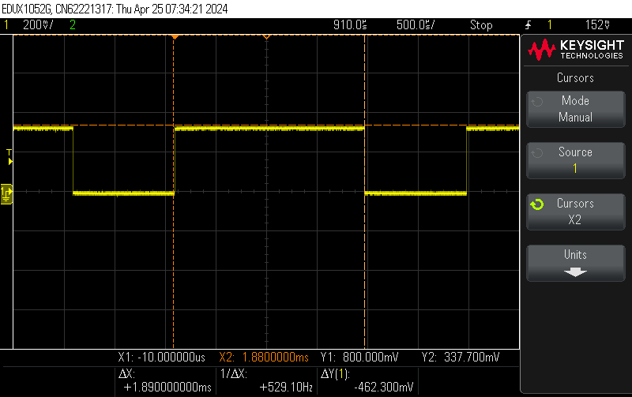
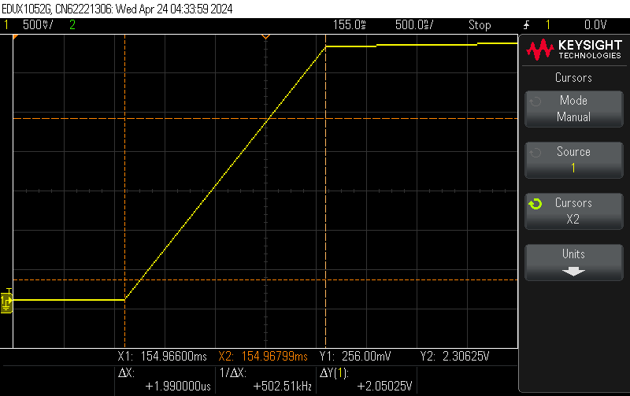
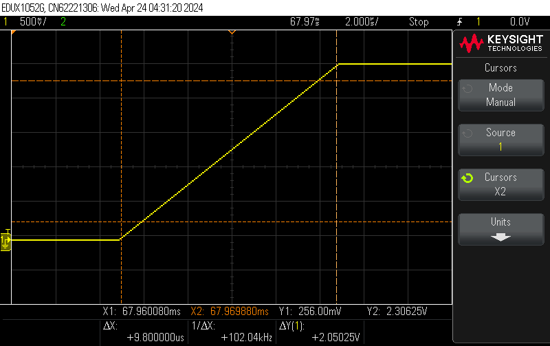

# MSP430 Mixed-Signal Waveform Generator

A register-level embedded C application built around the **Texas Instruments MSP430FR2355**, combining serial commands, analog acquisition, timer-driven PWM, waveform synthesis, and an internal DAC/op-amp signal path.

I developed this project to understand how individual microcontroller peripherals become a complete embedded system. A command received over UART can request an ADC measurement, change an actuator-control output, or start a synthesized analog waveform. Hardware timers provide deterministic timing, interrupts handle time-sensitive work, and the physical outputs were verified with an oscilloscope.

Although the project originated as embedded-systems laboratory work, I later reorganized the firmware into separate modules for communication, sensing, timing, actuation, waveform generation, and analog output. The resulting architecture reflects the same basic problems found in robotics, UAV avionics, and control systems: **receive commands, acquire sensor data, update outputs predictably, and verify what the hardware actually does.**

> **Clock assumption:** The timer and UART calculations in the current source assume the original laboratory configuration of a **24 MHz SMCLK**. The provided `src/` files do not include the clock-system configuration itself.

---

## System Architecture

The application connects a serial command interface to several digital and analog peripherals:

```text
                    Computer / Terminal
                            |
                     UART at 57,600 baud
                            |
                            v
                 +----------------------+
                 | Command Buffer and   |
                 | Application Handler  |
                 +----------+-----------+
                            |
          +-----------------+-----------------+
          |                 |                 |
          v                 v                 v
     12-Bit ADC        Timer B1 PWM     NCO Frequency
    Channels A1-A5     on P2.0 / TB1.1    Selection
          |                 |                 |
          v                 v                 v
     UART Response      Control Output    Timer B0 ISR
                                              |
                                              v
                                    32-Bit Phase Accumulator
                                              |
                                              v
                                      256-Sample Sine LUT
                                              |
                                              v
                                      12-Bit SAC3 DAC
                                              |
                                              v
                                    Internal Op-Amp Buffer
                                              |
                                              v
                                       P3.5 / OA3O
                                              |
                                              v
                                         Oscilloscope
```

The strongest part of this project was not any one peripheral. It was coordinating the interfaces between them while keeping timing-sensitive work separate from slower application logic.

---

## Firmware Architecture

The current implementation is divided by responsibility:

| Module | Responsibility |
| --- | --- |
| [`main.c`](src/main.c) | System initialization and application loop |
| [`uart.c`](src/uart.c) | UART reception, buffering, command decoding, and responses |
| [`adc.c`](src/adc.c) | ADC setup and channel acquisition |
| [`pwm.c`](src/pwm.c) | Timer-generated PWM and output-state commands |
| [`nco.c`](src/nco.c) | Phase accumulation and sine lookup |
| [`sac.c`](src/sac.c) | Internal DAC and op-amp configuration |
| [`timer.c`](src/timer.c) | Periodic timing, LED updates, and DAC waveform updates |

`main.c` stops the watchdog, initializes each peripheral module, enables interrupts, and then enters a small application loop:

```c
while (1)
{
    if (uart_command_ready())
    {
        uart_process_command();
    }
}
```

This keeps the top-level control flow easy to follow. Peripheral configuration stays inside its corresponding module, while the main loop responds to completed commands.

### Interrupt and Application Separation

The UART receive interrupt does not perform ADC conversions, change waveform frequencies, or execute motor commands directly. It receives one character at a time, builds a two-character command, and sets a ready flag:

```text
UART RX Interrupt
       |
       v
Receive Character
       |
       v
Build Two-Character Command
       |
       v
Set Command-Ready Flag
       |
       v
Return From Interrupt
```

Command interpretation happens later through `uart_process_command()` in normal application context:

```text
Main Loop
   |
   v
Check Ready Flag
   |
   v
Copy Command Safely
   |
   v
Decode and Execute
```

This was an important improvement over placing all application behavior inside an interrupt handler. The ISR handles the timing-sensitive receive event, while slower operations remain outside interrupt context.

Timer B0 has a different responsibility. Its interrupt occurs every millisecond and owns the periodic NCO/DAC update. Separating communication events from deterministic waveform timing makes the system easier to reason about and provides a useful pattern for embedded control firmware.

---

## Numerically Controlled Oscillator

The analog waveform is generated with a **32-bit numerically controlled oscillator**, or NCO. Instead of calculating a new sine value with a floating-point trigonometric function during every update, the firmware advances a phase accumulator and reads from a 256-entry lookup table.

```text
Requested Frequency
        |
        v
32-Bit Phase Increment
        |
        v
32-Bit Phase Accumulator
        |
        | Upper 8 bits
        v
256-Entry Signed Sine LUT
        |
        v
Signed 16-Bit Sample
        |
        v
Offset and Scale to 12 Bits
        |
        v
SAC3 DAC and Op-Amp
```

The NCO state is contained in `nco.c`:

```c
static uint32_t phase = 0;
static uint32_t delta = 0;
```

The requested frequency determines the phase increment:

```c
void nco_set_frequency(float frequency_hz)
{
    const float scaling_factor = 4294967.296f; /* 2^32 / 1000 Hz */

    delta =
        (uint32_t)((scaling_factor * frequency_hz) + 0.5f);
}
```

The scaling factor corresponds to `2^32 / 1000` because Timer B0 updates the NCO at 1 kHz. Each call to `nco_run()` advances the accumulator and uses its upper eight bits to select one of the 256 table entries:

```c
int16_t nco_run(void)
{
    phase += delta;
    return sinLUT[phase >> 24];
}
```

Using the upper eight bits naturally maps the 32-bit phase space onto the 256-entry table without division or floating-point sine calculation inside the timer interrupt.

### Timer-Driven DAC Updates

`timer.c` configures Timer B0 for a 1 ms period based on the assumed 24 MHz SMCLK and two divide-by-eight stages:

```c
TB0EX0 = TBIDEX_7;
TB0CCR0 = 375U;
TB0CTL = TBSSEL__SMCLK | ID__8 | MC__UP;
```

When waveform generation is enabled, the ISR obtains the next signed sample, offsets it into an unsigned range, reduces it to 12 bits, and sends it to the DAC:

```c
signed_sample = nco_run();

dac_sample =
    (uint16_t)(signed_sample + 32768L);

dac_sample >>= 4;

sac_set_dac(dac_sample);
```

This gives the waveform-generation path a fixed update schedule independent of how quickly the main loop processes commands.

The UART interface currently exposes three output frequencies:

| Command | Output behavior |
| --- | --- |
| `D0` | Stop the NCO and set the DAC to zero |
| `D1` | Generate a 40 Hz sine wave |
| `D2` | Generate an 80 Hz sine wave |
| `D3` | Generate a 100 Hz sine wave |
| `D4` | Stop the NCO and set the DAC to full scale |

---

## Why I Used a Lookup Table

Before implementing the NCO, I measured the cost of directly evaluating floating-point `sin()` on the microcontroller.

A GPIO was asserted immediately before the function call and cleared immediately afterward. Measuring the resulting pulse width with an oscilloscope converted software execution time into a physical signal:

```c
P1OUT |= BIT1;

sin(2);

P1OUT &= ~BIT1;
```



*GPIO pulse used to measure the execution time of a direct floating-point sine calculation.*

The observed execution time ranged from approximately **0.6 ms to 2.1 ms**, with a representative measurement of approximately **1.89 ms**. At the 24 MHz laboratory clock, that representative result corresponds to roughly **45,360 clock cycles**.

That timing experiment is not part of the current refactored source, but it motivated the implemented NCO architecture. A timer-driven waveform generator benefits from predictable work per update, so the final path uses integer addition, a bit shift, and a table lookup instead of repeatedly evaluating a trigonometric function.

---

## Mixed-Signal Output with SAC3

The MSP430FR2355 Smart Analog Combo integrates digital and analog functions within the microcontroller. In `sac.c`, SAC3 is configured so its internal 12-bit DAC drives the internal op-amp in buffer/voltage-follower mode.

```text
12-Bit DAC Code
       |
       v
+----------------+
| SAC3 DAC       |
+----------------+
       |
       v
+----------------+
| Internal       |
| Op-Amp Buffer  |
+----------------+
       |
       v
P3.5 / OA3O
       |
       v
Oscilloscope
```

The output is routed to P3.5/OA3O. The current implementation selects the SAC high-speed/high-power operating mode and provides a small interface for writing DAC values:

```c
void sac_set_dac(uint16_t value)
{
    if (value > 4095U)
    {
        value = 4095U;
    }

    SAC3DAT = value;
}
```

Clamping the input at 4095 keeps callers from writing beyond the 12-bit DAC range. The module also provides explicit zero and full-scale helper functions used by the UART command handler.

### Measuring the Analog Response

I characterized the SAC output by switching the DAC between minimum and maximum codes and measuring the transition with an oscilloscope.



*Measured SAC DAC/op-amp transition in high-speed mode: approximately 1.65 V/µs.*



*Measured SAC DAC/op-amp transition in low-speed mode: approximately 0.33 V/µs.*

The measured high-speed transition was approximately **1.65 V/µs**, compared with approximately **0.33 V/µs** in low-speed mode.

The specific values depend on the hardware configuration and measurement setup, but the experiment demonstrated an important embedded-hardware lesson: setting a peripheral register is not the same as verifying its physical behavior. The output still needs to be measured under the actual loading, probe, and signal-path conditions.

---

## ADC Acquisition

`adc.c` configures the internal ADC for **12-bit, single-channel, single-conversion operation**. The implementation supports channels A1 through A5 using one channel-selection function rather than separate code for each input:

```c
uint16_t adc_read_channel(uint8_t channel)
{
    if (channel < 1U || channel > 5U)
    {
        return 0U;
    }

    ADCCTL0 &= ~ADCENC;
    ADCMCTL0 &= ~ADCINCH_15;
    ADCMCTL0 |= channel;
    ADCCTL0 |= ADCENC;

    return adc_get_reading();
}
```

`adc_get_reading()` starts the conversion, waits while the ADC is busy, and returns `ADCMEM0`:

```c
ADCCTL0 |= ADCSC;

while (ADCCTL1 & ADCBUSY)
{
}

return ADCMEM0;
```

The command handler converts `A1` through `A5` into a channel number, performs the conversion, and transmits the unsigned result over UART.

This is a simple blocking implementation, but it demonstrates the full sensor-acquisition path:

```text
UART Channel Request
        |
        v
Select ADC Input
        |
        v
Start 12-Bit Conversion
        |
        v
Wait for Completion
        |
        v
Read ADCMEM0
        |
        v
Return Value Over UART
```

That same pattern—select an input, acquire a measurement, and report it through a communication interface—is directly applicable to embedded sensing and control systems.

---

## PWM Output and Actuator Commands

`pwm.c` uses Timer B1 to generate a PWM output on **P2.0 / TB1.1**.

With the assumed 24 MHz SMCLK and two divide-by-eight stages, `TB1CCR0 = 7500` produces an approximately 20 ms PWM period. The output uses reset/set mode, while `TB1CCR1` controls the active pulse width.

The firmware exposes three command states:

```c
void motor_stop(void)
{
    TB1CCR1 = 0U;
}

void motor_clockwise(void)
{
    TB1CCR1 = 525U;
}

void motor_counterclockwise(void)
{
    TB1CCR1 = 750U;
}
```

The repository does not define the external motor hardware, so I treat this as a simple PWM-based actuator interface rather than claiming a specific motor or drive architecture.

The important firmware concept is that a serial command is translated into a deterministic hardware-timer output without software-generated pulse timing. That pattern is useful in robotics, UAV, and control applications where communication and actuator timing need to coexist.

---

## UART Command Interface

The application uses eUSCI_A1 at **57,600 baud**, based on the original 24 MHz SMCLK configuration. Received commands are two characters long.

| Command | Action |
| --- | --- |
| `R0` / `R1` | Turn the red LED off/on |
| `G0` / `G1` | Turn the green LED off/on |
| `A1`–`A5` | Read ADC channel A1–A5 and return the result |
| `M0` | Set the PWM output to the stopped state |
| `M1` | Set the clockwise PWM command |
| `M2` | Set the counterclockwise PWM command |
| `D0` | Disable the NCO and set the DAC to zero |
| `D1` | Generate a 40 Hz sine wave |
| `D2` | Generate an 80 Hz sine wave |
| `D3` | Generate a 100 Hz sine wave |
| `D4` | Disable the NCO and set the DAC to full scale |

A command such as `D2` crosses several firmware and hardware boundaries:

```text
"D2" Received
      |
      v
UART RX Interrupt
      |
      v
Command Buffer
      |
      v
Main-Loop Command Handler
      |
      v
nco_set_frequency(80.0f)
      |
      v
Timer B0 Update at 1 kHz
      |
      v
Phase Accumulator and Sine LUT
      |
      v
12-Bit DAC Code
      |
      v
SAC3 Op-Amp Output
      |
      v
Measured Analog Waveform
```

That end-to-end path—from communication input to a physical output—is the main reason I include this project in my portfolio.

---

## What I Would Improve Today

The current implementation is intentionally small and understandable, but several changes would make it easier to expand into a larger embedded-control application.

First, I would replace the fixed two-character command format with a parser that supports variable-length commands, parameters, acknowledgments, and explicit error responses. That would allow commands such as a requested waveform frequency or PWM value instead of limiting the interface to predefined states.

I would also make ADC acquisition nonblocking. The current implementation polls `ADCBUSY`, which is reasonable for a simple command-driven measurement but prevents the application from doing other work during conversion. An interrupt-driven or event-based ADC path would fit better in a system sampling multiple sensors while continuing to process communication and control tasks.

The module boundaries could also be strengthened. The current files organize register access by peripheral, but application behavior still depends directly on global flags and command-specific hardware calls. I would introduce clearer application-level interfaces and keep MCU-specific register configuration behind the peripheral layer.

Finally, I would add host-side tests for command parsing and NCO calculations, along with explicit status reporting for invalid commands, unavailable channels, and peripheral failures. These changes would improve testability without making the time-critical interrupt paths more complicated.

---

## Relevance to Robotics, UAVs, and Control Systems

This project was not deployed on a robot or aircraft, but its architecture maps naturally to those systems:

```text
Command or Telemetry Input
            |
            v
Application State and Control Logic
            |
       +----+----+
       |         |
       v         v
Sensor Input   Actuator Output
   ADC           PWM
       \         /
        \       /
         v     v
      Deterministic Timing
              |
              v
     Physical Measurement
```

Robotics and UAV firmware regularly combines sensor acquisition, timed control outputs, serial communication, and hardware validation. The specific peripherals may change, but the architectural questions remain similar:

- What work belongs in an interrupt?
- What work can wait for normal application context?
- Which outputs require hardware-timed behavior?
- How should sensor and actuator interfaces be separated?
- How can software behavior be verified at the electrical interface?

This project gave me practical experience answering those questions on real hardware rather than treating each peripheral as an isolated exercise.

---

## Repository Structure

```text
.
├── README.md
├── Images/
│   ├── sac_high_speed_slew_rate.png
│   ├── sac_low_speed_slew_rate.png
│   └── sine_computation_timing.png
└── src/
    ├── README_BUILD_NOTE.md
    ├── adc.c
    ├── adc.h
    ├── main.c
    ├── nco.c
    ├── nco.h
    ├── pwm.c
    ├── pwm.h
    ├── sac.c
    ├── sac.h
    ├── timer.c
    ├── timer.h
    ├── uart.c
    └── uart.h
```

---

## Project Background

This project originated from embedded-systems laboratory work using the MSP430FR2355. Those exercises introduced UART, ADC conversion, hardware timers, PWM, motor commands, the Smart Analog Combo, and waveform generation.

I later reorganized the firmware so those features operate as parts of one modular mixed-signal application. The most important takeaway was learning to follow behavior through the entire system:

```text
Software Command
       |
       v
Application Logic
       |
       v
Timer or Peripheral
       |
       v
Digital or Analog Output
       |
       v
Physical Measurement
```

That combination of **embedded firmware architecture, deterministic timing, sensor and actuator interfaces, mixed-signal hardware, and oscilloscope-based validation** is the experience I want to continue building on in robotics, UAV avionics, and control-system development.
